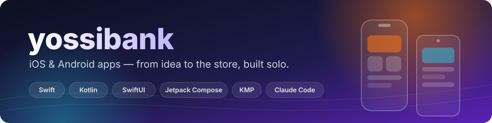
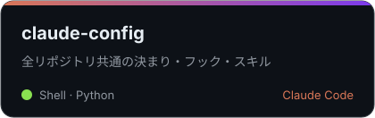
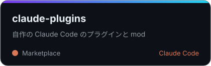

# yossibank

個人開発のアプリとテンプレートの一覧。

## 📱 アプリ

<table>
  <tr>
    <td width="50%" valign="top">

### かけいぼっと

- 見返すのが楽しい家計簿：レシートの読み取り・着せ替え・家族と共有
- ✅ 公開中
- 🍎 iOS ・ 🤖 Android

</td>
    <td width="50%" valign="top">

### しふとけい

- シフトを入れるだけで、給料の見込みと年収の壁までの残りが分かる
- 🚧 作っている
- 🍎 iOS

</td>
  </tr>
</table>

## 📦 テンプレート

<table>
  <tr>
    <td></td>
    <td></td>
    <td valign="top">

- [🧩 kmp-app-template](https://github.com/yossibank/kmp-app-template)：共通コア
- [🍎 ios-app-template](https://github.com/yossibank/ios-app-template)：iOS アプリ
- [🤖 android-app-template](https://github.com/yossibank/android-app-template)：Android アプリ

</td>
  </tr>
</table>

## 🧰 Claude Code の道具

